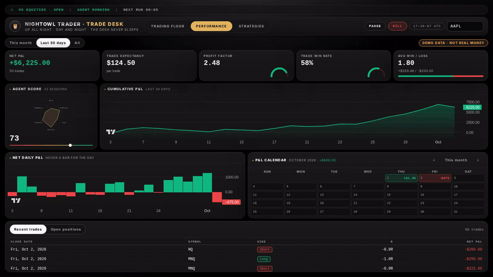
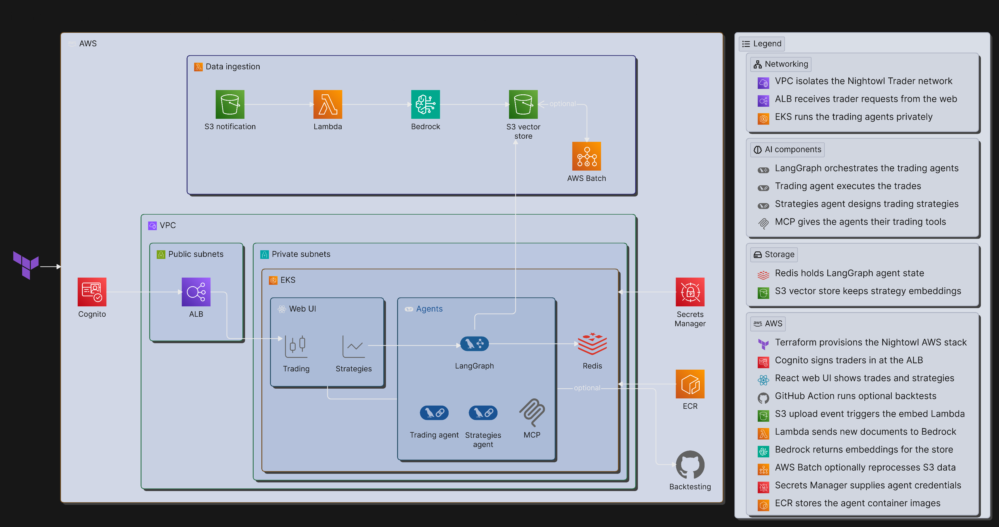

# Nightowl Trader

## See it work

Open-source AI trading agents, deployed into your own AWS and handed over as a working product. Agents watch the market, size a signal, enforce hard-coded risk limits and execute through [Alpaca](https://alpaca.markets/). Every decision is logged for replay, and paper trading is on by default: nothing touches real money until it is switched on. On-prem and AWS production both read one S3 vector store, which a single ingestion pipeline fills. The trading desk fills one viewport: Performance, the Trading Floor and Strategies. **Walk the desk.** The clip opens on Performance, switches the range to All and the bottom panel to open positions, pauses the auto loop so nothing is sent, types MSFT on the Trading Floor and picks confidence 0.8, then opens Strategies and refreshes the registry.

## Architecture

Traders sign in through Cognito at the ALB and land on an EKS-hosted desk of LangGraph agents, with Redis holding agent state and Secrets Manager supplying credentials. One ingestion pipeline, an S3 notification through Lambda and [Amazon Bedrock](https://aws.amazon.com/bedrock/) with AWS Batch optional, fills the S3 vector store the agents read.

## Capabilities

| Capability | What it does | Why it matters |
|---|---|---|
| **Trading desk** | Three pages fill one viewport: Performance (P&L and open positions), the Trading Floor (a [TradingView Lightweight Charts](https://github.com/tradingview/lightweight-charts) chart and an order ticket) and Strategies (the registry). | The whole book is one screen: no tab switching to see a position, size an order or review a strategy. |
| **Trading agents** | [LangGraph](https://github.com/langchain-ai/langgraph) orchestrates the agents that watch the market and size a signal. | Open source agents you can read, fork and run yourself, not a black box. |
| **Deterministic risk gate** | Every signal is sized, then risk-gated against hard-coded limits, before any order reaches the broker, [Alpaca](https://alpaca.markets/). The model proposes; the rules decide. | Risk cannot be talked around by a language model. The rules are the product. |
| **Strategy loop** | A post in the team channel becomes transcripts, the transcripts become deterministic rules through [Amazon Bedrock](https://aws.amazon.com/bedrock/), the rules are backtested against the Nasdaq buy-and-hold with [backtesting.py](https://github.com/kernc/backtesting.py), and only a passing set asks for approval by email with signed Yes/No links per rule. | Only proven strategies reach the desk, and a single No prunes that rule and re-backtests it. |
| **Replay** | Every decision is logged for replay. | Any trade can be explained after the fact from the record. |

## License

PolyForm Noncommercial 1.0.0: free for noncommercial use; resale or any commercial use needs written permission first. See [LICENSE](LICENSE).
