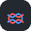
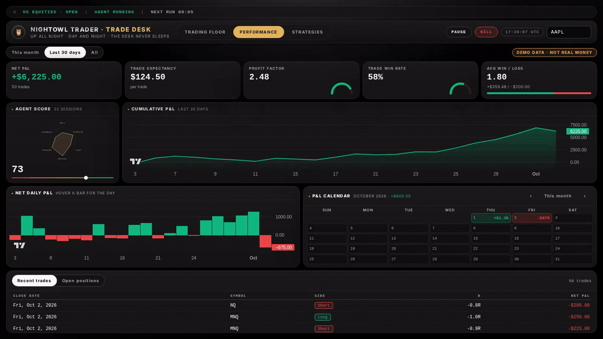
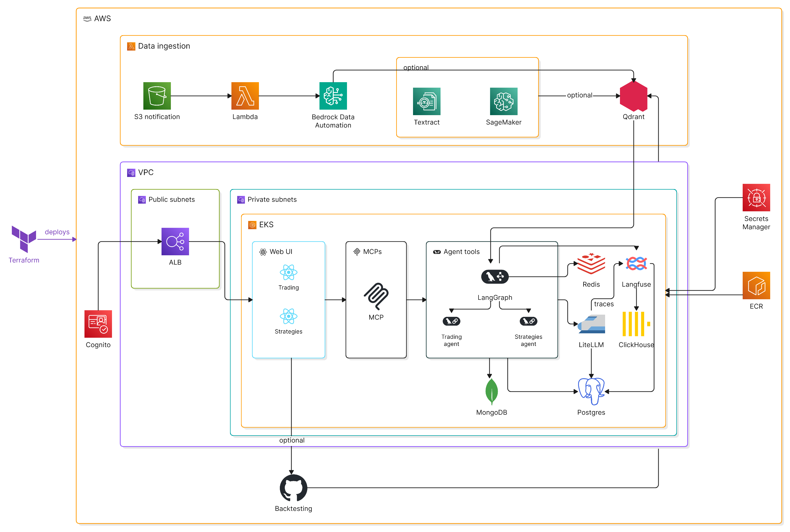

# Nightowl Trader

## Executive summary

Nightowl Trader is open-source AI trading agents that run in your own AWS account: they watch the market, size a signal, check it against hard-coded risk limits and trade through [Alpaca](https://alpaca.markets/). Paper trading is on by default, so no real money moves until you switch it on, and every decision is logged for replay.  [Terraform](https://www.terraform.io/) deploys it to  [Amazon EKS](https://aws.amazon.com/eks/) inside a  [VPC](https://aws.amazon.com/vpc/), behind an  [Application Load Balancer](https://aws.amazon.com/elasticloadbalancing/application-load-balancer/) where  [Cognito](https://aws.amazon.com/cognito/) authenticates every request;  [GitHub Actions](https://github.com/features/actions) builds the images into  [Amazon ECR](https://aws.amazon.com/ecr/), and credentials come from  [Secrets Manager](https://aws.amazon.com/secretsmanager/) at run time. The  [React](https://react.dev/) desk fits one screen, in three views:

- **Performance:** profit and loss, and the open positions behind it.
- **Trading Floor:** a  [TradingView Lightweight Charts](https://github.com/tradingview/lightweight-charts) chart and an order ticket. Behind it, a  [LangGraph](https://www.langchain.com/langgraph) team of  [LangChain](https://www.langchain.com/) agents over  [MCP](https://modelcontextprotocol.io/) sizes each signal and passes it through the risk check before it reaches the broker;  [Redis](https://redis.io/) holds agent state and  [PostgreSQL](https://www.postgresql.org/) stores each run.
- **Strategies:** the registry. A channel post becomes transcripts,  [Amazon Bedrock](https://aws.amazon.com/bedrock/) turns them into rules, and each strategy is backtested against Nasdaq buy-and-hold with [backtesting.py](https://github.com/kernc/backtesting.py) before it reaches the desk. A passing set asks for approval by email, with a signed Yes/No link per rule.  [LiteLLM](https://litellm.ai/) routes the model calls to DeepSeek, traced in  [Langfuse](https://langfuse.com/).

The document ingestion pipeline is drawn below; it is not wired to the desk yet.

## In action

**Walk the desk.** The clip opens on Performance, switches the range to All and the bottom panel to open positions, pauses the auto loop, types MSFT on the Trading Floor with confidence 0.8, then refreshes the Strategies registry. (Recorded on demo data.)

## Architecture

Nightowl Trader: one AWS deployment serves the React trading pages and the LangGraph agents, fed by one Qdrant vector store.

## License

PolyForm Noncommercial 1.0.0 with a required notice from Haya Tech LLC. Noncommercial use is free; any commercial use, including resale, hosting for others, or a paid product, needs a written license from Haya Tech LLC first. See [LICENSE](LICENSE).
